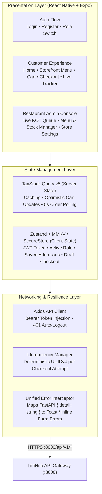
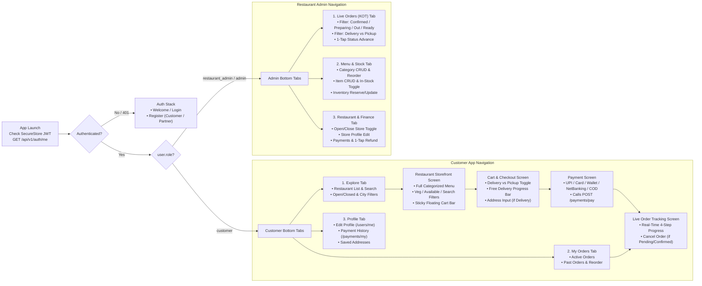
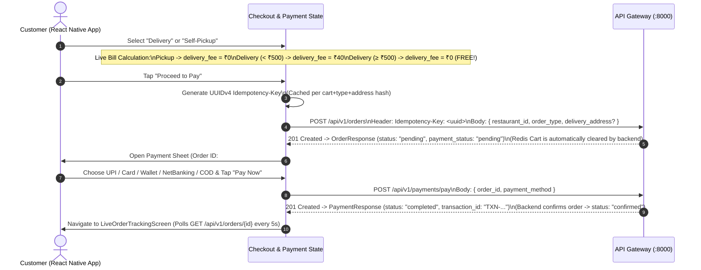

# LittiHub — React Native Frontend System Design

This system design translates the **LittiHub** backend microservices and API Gateway ([`backend/api-gateway`](file:///home/anand/data1/LittiHub/backend/api-gateway/app/main.py)) into a fast, intuitive, and production-ready **React Native** mobile application architecture.

---

## 1. Product & UX Strategy (Keeping the App User-Friendly)

Analysis of the LittiHub backend reveals two primary personas operating through the unified API Gateway (`:8000`):
1. **Customer (`role: "customer"`)**: Browses restaurants & categorized menus, builds a cart, chooses **Delivery** or **Self-Pickup**, pays via UPI/Card/Wallet/NetBanking/COD, and tracks live order status.
2. **Restaurant Admin (`role: "restaurant_admin"` | `"admin"`)**: Toggles store open/close status, manages menu categories/items/availability/inventory, processes incoming kitchen orders (`CONFIRMED` → `PREPARING` → `OUT_FOR_DELIVERY` / `READY_FOR_PICKUP` → `DELIVERED` / `PICKED_UP`), and views/refunds payments.

> [!TIP]
> **Role-Adaptive Single App vs. Dual App**
> For rapid development in React Native, build a **single codebase with Role-Based Root Navigation**. Upon login ([`POST /api/v1/auth/login`](file:///home/anand/data1/LittiHub/backend/api-gateway/app/routers/auth.py#L57-L63)), inspect `user.role` from the JWT/response:
> - Route `"customer"` to the **Customer Storefront Tab Navigator**.
> - Route `"restaurant_admin"` or `"admin"` to the **Restaurant Partner Kitchen & Menu Console**.

### Core UX Pillars for High Conversion & Ease of Use
- **Zero-Friction Onboarding**: [`POST /api/v1/auth/register`](file:///home/anand/data1/LittiHub/backend/api-gateway/app/routers/auth.py#L45-L54) only returns `UserResponse` (without a token). The app should automatically chain `register` → `login` → `POST /api/v1/users/profile` in a single "Sign Up" tap so the user lands directly on the home screen.
- **Sticky Category Pills & 60fps Menu Scrolling**: Use [`GET /api/v1/restaurants/{id}/menu?only_available=true`](file:///home/anand/data1/LittiHub/backend/api-gateway/app/routers/menu.py#L50-L63) to fetch the entire categorized menu in one network call. Render categories in a synchronized `SectionList` / `FlashList` with aVeg-Only quick-toggle chip and instant client-side search.
- **Optimistic `[- 1 +]` Item Steppers**: Tapping **ADD** or **`+`/`-`** updates the UI immediately while syncing with [`/api/v1/cart/items`](file:///home/anand/data1/LittiHub/backend/api-gateway/app/routers/cart.py#L45-L80) in the background.
- **Floating Bottom Cart Bar**: Whenever `cart.total_items > 0`, display a persistent floating bar above the bottom tabs showing `"2 Items | ₹280 • View Cart →"`.
- **Smart Free-Delivery Upsell & Pickup Toggle**: [`OrderService._calculate_delivery_fee`](file:///home/anand/data1/LittiHub/backend/services/order-service/app/services/order_service.py#L459-L470) charges `₹40` for delivery below `₹500` and `₹0` for `>= ₹500` or `pickup`. Show a live progress bar in the cart: *"Add ₹{500 - subtotal} more for FREE Delivery, or switch to Self-Pickup to save ₹40!"*
- **1-Tap Kitchen Order Tickets (KOT) for Admins**: Give restaurant staff colour-coded order cards with a single primary action button that advances the state machine (`Start Preparing` → `Mark Ready for Pickup` / `Dispatch Delivery` → `Complete Order`).

---

## 2. High-Level Frontend Architecture & Tech Stack



### Recommended React Native Tech Stack

| Layer | Recommended Library | Why It Fits LittiHub |
| :--- | :--- | :--- |
| **Framework & Routing** | **Expo (Managed Workflow) + Expo Router** (or React Navigation v7) | File-based routing, deep-linking support for order tracking, and instant OTA updates. |
| **Server State & Caching** | **TanStack Query (React Query v5)** | Handles menu caching, optimistic cart mutations, and automatic polling (`refetchInterval`) for live order tracking. |
| **Client State & Storage** | **Zustand** + `expo-secure-store` + `react-native-mmkv` | Securely stores the JWT `access_token` (`expo-secure-store`) and persists user addresses, veg filter, and checkout draft (`mmkv`). |
| **Lists & Performance** | **@shopify/flash-list** | Smooth 60fps scrolling for large restaurant menus and admin order queues. |
| **Forms & Validation** | **React Hook Form + Zod** | Mirrors FastAPI Pydantic validation rules (`min_length`, `gt`, `le`, `EmailStr`) on the client before network calls. |
| **UI & Animations** | **NativeWind (Tailwind v4)** + **React Native Reanimated 3** + **@gorhom/bottom-sheet** | Smooth cart bottom sheets, animated order status progress bars, and clean warm food-delivery styling. |

---

## 3. Navigation Architecture & Screen Hierarchy



---

## 4. Screen-by-Screen UX & API Integration Blueprint

### 4.1 Authentication & Profile Onboarding (`auth-service` + `user-service`)

> [!IMPORTANT]
> **All LittiHub Gateway endpoints require `Authorization: Bearer <token>`**, including [`GET /api/v1/restaurants`](file:///home/anand/data1/LittiHub/backend/api-gateway/app/routers/restaurants.py#L58-L74) and [`GET /api/v1/restaurants/{id}/menu`](file:///home/anand/data1/LittiHub/backend/api-gateway/app/routers/menu.py#L50-L63). Users must authenticate before browsing.

#### Seamless Sign-Up Orchestration
Because `auth-service` and `user-service` maintain separate MongoDB collections, the React Native `useRegisterMutation` hook should chain three calls transparently behind a single **"Create Account"** button:
1. **`POST /api/v1/auth/register`** with `{ email, password, first_name, last_name, role }`.
2. **`POST /api/v1/auth/login`** with `{ email, password }` → receives `{ access_token, token_type, user }`. Save `access_token` in `SecureStore`.
3. **`POST /api/v1/users/profile`** with `{ first_name, last_name, phone }` using the new Bearer token. (If `GET /api/v1/users/me` ever returns `404` for an existing user, lazily call `POST /api/v1/users/profile` in the background).

| Screen / Feature | Method & Endpoint | Request Payload / Params | Response Schema |
| :--- | :--- | :--- | :--- |
| **Register** | `POST /api/v1/auth/register` | `{ email, password (≥8), first_name, last_name, role }` | `UserResponse` (`id, email, first_name, last_name, role, is_active, is_verified, created_at`) |
| **Login** | `POST /api/v1/auth/login` | `{ email, password }` | `LoginResponse` (`access_token, token_type, user: UserResponse`) |
| **Verify Session** | `GET /api/v1/auth/me` | Header: `Authorization: Bearer <token>` | `UserResponse` |
| **Create User Profile** | `POST /api/v1/users/profile` | `{ first_name, last_name, phone? }` | `UserProfileResponse` (`id, auth_user_id, first_name, last_name, phone, created_at, updated_at`) |
| **Get My Profile** | `GET /api/v1/users/me` | Header: `Authorization` | `UserProfileResponse` (returns `404` if profile not created yet) |
| **Update My Profile** | `PATCH /api/v1/users/me` | `{ first_name?, last_name?, phone? }` | `UserProfileResponse` |

---

### 4.2 Customer Experience: Discovery, Storefront Menu & Smart Cart

#### Screen 1: Home / Restaurant Discovery (`HomeScreen.tsx`)
- **Header**: City selector dropdown (e.g., *Patna*, *Delhi*, *All Cities*) + Search input with 300ms debounce.
- **Quick Filter Chips**: `"Open Now"` (`is_open=true`), `"All Restaurants"`.
- **Restaurant Cards**: Show name, description, address/city, and a live badge (`🟢 Open Now` vs `🔴 Closed`). If `is_open === false`, dim the card slightly and show *"Currently Closed (Browse Menu Only)"*—preventing frustration at checkout where [`OrderService.create_order`](file:///home/anand/data1/LittiHub/backend/services/order-service/app/services/order_service.py#L143-L146) rejects closed restaurants.

#### Screen 2: Restaurant Storefront & Menu (`RestaurantMenuScreen.tsx`)
- **Single Composite Query**: Fetch [`GET /api/v1/restaurants/{restaurant_id}/menu`](file:///home/anand/data1/LittiHub/backend/api-gateway/app/routers/menu.py#L50-L63) alongside [`GET /api/v1/cart`](file:///home/anand/data1/LittiHub/backend/api-gateway/app/routers/cart.py#L35-L42).
- **Dietary & Search Bar**:
  - Client-side or server-side (`GET /api/v1/restaurants/{id}/items?is_vegetarian=true&search=...`) filtering.
  - Display standard Indian food-delivery **Veg (🟢 square-dot)** and **Non-Veg (🔴 triangle/dot)** badges using `item.is_vegetarian`, plus preparation time (`⏱ 15 mins` from `item.preparation_time_minutes`).
- **Menu Item Card & Stepper Logic**:
  - Cross-reference `cart.items` by `menu_item_id` in $O(1)$ using a memoized map `Record<string, CartItemResponse>`.
  - If `item.is_available === false`: Show a muted `"Sold Out"` badge and disable the `ADD` button.
  - If `quantity === 0`: Show **`[ + ADD ]`** → calls `POST /api/v1/cart/items` with `{ restaurant_id, menu_item_id, quantity: 1 }`.
  - If `quantity >= 1`: Show **`[ - | {quantity} | + ]`**:
    - Tapping **`+`** (up to `20`): calls `PATCH /api/v1/cart/items/{menu_item_id}` with `{ quantity: quantity + 1 }`. Disable `+` at `20` with a subtle toast *"Max 20 per dish"*.
    - Tapping **`-`** when `quantity > 1`: calls `PATCH /api/v1/cart/items/{menu_item_id}` with `{ quantity: quantity - 1 }`.
    - Tapping **`-`** when `quantity === 1`: calls `DELETE /api/v1/cart/items/{menu_item_id}` (since `UpdateCartItemRequest` requires `quantity > 0`).

> [!WARNING]
> **Handling Single-Restaurant Cart Conflicts Gracefully**
> [`CartService._validate_restaurant`](file:///home/anand/data1/LittiHub/backend/services/cart-service/app/services/cart_service.py#L298-L310) enforces that a cart can only hold items from one `restaurant_id` at a time.
> - **UX Solution**: Before calling `POST /api/v1/cart/items`, check if `cart.restaurant_id && cart.restaurant_id !== currentRestaurant.id && cart.total_items > 0`.
> - If true, present a bottom sheet: **"Replace cart item?"** (*"Your cart contains dishes from another restaurant. Do you want to discard them and add dishes from {currentRestaurant.name}?"*).
> - On confirm: call `DELETE /api/v1/cart` followed by `POST /api/v1/cart/items`.
> - **Note on `DELETE /api/v1/cart`**: In [`cart_client.py`](file:///home/anand/data1/LittiHub/backend/api-gateway/app/clients/cart_client.py), if clearing the entire cart encounters a `204` parsing issue on the gateway, you can either fix `cart_client.py` to handle `204` or remove the last item via `DELETE /api/v1/cart/items/{menu_item_id}` which cleanly deletes the cart and returns an empty `CartResponse` JSON!

| Screen / Feature | Method & Endpoint | Query / Body | Response Schema |
| :--- | :--- | :--- | :--- |
| **List Restaurants** | `GET /api/v1/restaurants` | `?page=1&page_size=10&city=&is_open=&search=` | `RestaurantListResponse` (`items: RestaurantResponse[], page, page_size, total, total_pages`) |
| **Restaurant Details** | `GET /api/v1/restaurants/{id}` | — | `RestaurantResponse` (`id, name, slug, description, phone, address, city, state, pincode, is_active, is_open`) |
| **Full Storefront Menu** | `GET /api/v1/restaurants/{id}/menu` | `?only_available=false` | `FullMenuResponse` (`restaurant_id, categories: [{ id, name, description, display_order, items: MenuItemResponse[] }]`) |
| **Filter/Search Items** | `GET /api/v1/restaurants/{id}/items` | `?category_id=&is_vegetarian=&is_available=&search=` | `MenuItemResponse[]` |
| **Get Active Cart** | `GET /api/v1/cart` | — | `CartResponse` (`user_id, restaurant_id, items: CartItemResponse[], subtotal, total_items`) |
| **Add Item to Cart** | `POST /api/v1/cart/items` | `{ restaurant_id, menu_item_id, quantity (1..20) }` | `CartResponse` |
| **Update Item Qty** | `PATCH /api/v1/cart/items/{menu_item_id}` | `{ quantity (1..20) }` | `CartResponse` |
| **Remove Item** | `DELETE /api/v1/cart/items/{menu_item_id}` | — | `CartResponse` |
| **Clear Cart** | `DELETE /api/v1/cart` | — | `204 No Content` |

---

### 4.3 Checkout, Payment & Real-Time Order Tracking (`order-service` + `payment-service`)



#### Screen 3: Cart & Checkout (`CheckoutScreen.tsx`)
1. **Fulfillment Segmented Control**:
   - **🛵 Delivery (`"delivery"`)**: Shows saved addresses (stored locally in MMKV) or an address input form (`min_length=5, max_length=500`, enforced by [`OrderService.create_order`](file:///home/anand/data1/LittiHub/backend/services/order-service/app/services/order_service.py#L52-L60)).
   - **🛍️ Self-Pickup (`"pickup"`)**: Hides address input, displays the restaurant's pickup address from `RestaurantResponse`, and sets `delivery_fee = ₹0`.
2. **Transparent Bill Summary Card**:
   - Item Subtotal: `₹{cart.subtotal}`
   - Delivery Fee:
     - If `order_type === "pickup"`: `₹0 (Self-Pickup)`
     - If `order_type === "delivery"` and `cart.subtotal >= 500`: `~~₹40~~ FREE`
     - If `order_type === "delivery"` and `cart.subtotal < 500`: `₹40` (with a banner: *"Add items worth ₹{500 - cart.subtotal} more for FREE delivery!"*)
   - Grand Total: `₹{subtotal + deliveryFee}`
3. **Idempotency-Key Management**:
   - Generate a `uuidv4()` when the user enters Checkout and store it in component/Zustand state tied to `JSON.stringify({ restaurant_id, order_type, delivery_address, items })`.
   - If the network drops during `POST /api/v1/orders` and the user taps **Retry**, send the **exact same `Idempotency-Key`** so [`OrderService`](file:///home/anand/data1/LittiHub/backend/services/order-service/app/services/order_service.py#L90-L116) returns the existing order without duplicating it.
   - If the user modifies their cart, `order_type`, or `delivery_address`, generate a fresh `Idempotency-Key` (otherwise backend returns `400 "Idempotency key was already used for a different checkout request"`).

#### Screen 4: Payment Sheet & Unpaid Order Recovery (`PaymentModal.tsx`)
- Supports all 5 backend [`PaymentMethod`](file:///home/anand/data1/LittiHub/backend/api-gateway/app/routers/payments.py#L9-L14) options:
  1. **UPI** (`"upi"`) — Default recommended option
  2. **Credit / Debit Card** (`"card"`)
  3. **Mobile Wallets** (`"wallet"`)
  4. **Net Banking** (`"net_banking"`)
  5. **Cash / Pay on Delivery** (`"cod"`)
- **Unpaid Order Recovery**: Because `POST /api/v1/orders` clears the Redis cart immediately and creates a `pending` order, if a user closes the app before `POST /api/v1/payments/pay`, the order remains in `status: "pending"`. On the **My Orders** and **Order Details** screens, any order with `status === "pending"` and `payment_status === "pending"` should display a prominent **"Complete Payment (₹{total_amount})"** button that opens `PaymentModal` for that `order.id`.

#### Screen 5: Live Order Tracking (`OrderTrackingScreen.tsx`)
- Poll [`GET /api/v1/orders/{order_id}`](file:///home/anand/data1/LittiHub/backend/api-gateway/app/routers/orders.py#L113-L124) with TanStack Query `refetchInterval: 5000` while the order is in a non-terminal state (`pending`, `confirmed`, `preparing`, `out_for_delivery`, `ready_for_pickup`), and stop polling (`false`) once `delivered`, `picked_up`, or `cancelled`.
- **Dynamic 4-Step Visual Stepper**:
  - **For `order_type === "delivery"`**:
    1. `confirmed` — *Order Confirmed (Kitchen has received your order)*
    2. `preparing` — *Chef is Preparing Your Food*
    3. `out_for_delivery` — *Out for Delivery (On the way to your address)*
    4. `delivered` — *Delivered • Enjoy your Litti!*
  - **For `order_type === "pickup"`**:
    1. `confirmed` — *Order Confirmed*
    2. `preparing` — *Chef is Preparing Your Food*
    3. `ready_for_pickup` — *Ready for Pickup at Counter!*
    4. `picked_up` — *Picked Up • Enjoy your meal!*
- **Customer Cancellation Guardrail**:
  - Per [`OrderService.update_order_status`](file:///home/anand/data1/LittiHub/backend/services/order-service/app/services/order_service.py#L359-L367) and [`_validate_status_transition`](file:///home/anand/data1/LittiHub/backend/services/order-service/app/services/order_service.py#L477-L520), customers can **only** transition an order to `"cancelled"` while `status` is `"pending"` or `"confirmed"`.
  - Show a `"Cancel Order"` outline button **only** when `order.status === "pending" || order.status === "confirmed"`. Once `order.status === "preparing"`, hide the button and display *"Order is being prepared and can no longer be cancelled."*

---

### 4.4 Restaurant Admin Portal Experience (`admin` & `restaurant_admin`)

#### Tab 1: Live Kitchen Order Queue (`AdminOrdersScreen.tsx`)
- **Top Bar**: Global **Store Open / Closed Switch** bound to [`PATCH /api/v1/admin/restaurants/{restaurant_id}/open-status`](file:///home/anand/data1/LittiHub/backend/api-gateway/app/routers/admin.py#L35-L47) (`{ is_open: boolean }`).
- **Status Filter Tabs** (queries [`GET /api/v1/admin/restaurants/{restaurant_id}/orders?status=...&order_type=...`](file:///home/anand/data1/LittiHub/backend/api-gateway/app/routers/admin.py#L116-L135) with 5s auto-refresh):
  - **New (`confirmed`)** → Primary CTA button: **"🔥 Start Preparing"** (`PATCH .../orders/{id}/status` with `{ status: "preparing" }`)
  - **Cooking (`preparing`)** → Primary CTA button depends on `order.order_type`:
    - If `delivery`: **"🛵 Dispatch for Delivery"** (`{ status: "out_for_delivery" }`)
    - If `pickup`: **"🛍️ Mark Ready for Pickup"** (`{ status: "ready_for_pickup" }`)
  - **In Transit / Ready (`out_for_delivery` | `ready_for_pickup`)** → Primary CTA:
    - If `delivery`: **"✅ Mark Delivered"** (`{ status: "delivered" }`)
    - If `pickup`: **"✅ Mark Picked Up"** (`{ status: "picked_up" }`)
  - **Completed / Cancelled History**

#### Tab 2: Menu & Stock Manager (`AdminMenuScreen.tsx`)
- **Category Management**: List categories (`GET /api/v1/restaurants/{id}/categories`), create (`POST /api/v1/admin/restaurants/{id}/categories`), reorder (`display_order`), or soft-delete/restore.
- **Dish Quick-Toggle**: Every dish row has an instant **In-Stock Switch** calling [`PATCH /api/v1/admin/restaurants/{restaurant_id}/items/{item_id}/availability`](file:///home/anand/data1/LittiHub/backend/api-gateway/app/routers/admin.py#L82-L96) (`{ is_available: boolean }`).
- **Inventory Stock Badge**: Fetch stock via [`GET /api/v1/inventory/restaurant/{restaurant_id}/menu-item/{menu_item_id}`](file:///home/anand/data1/LittiHub/backend/api-gateway/app/routers/inventory.py#L59-L74) (`quantity, reserved_quantity, available_quantity`) and allow quick stock top-ups via `POST /api/v1/inventory` or `PATCH /api/v1/inventory/{inventory_id}`.

#### Tab 3: Payments & Refunds (`AdminPaymentsScreen.tsx`)
- Lists restaurant transactions via [`GET /api/v1/admin/restaurants/{restaurant_id}/payments`](file:///home/anand/data1/LittiHub/backend/api-gateway/app/routers/admin.py#L158-L168).
- For any payment with `status === "completed"` (e.g., when a confirmed order was cancelled before preparation), provide a **"Refund Payment"** button calling [`POST /api/v1/payments/{payment_id}/refund`](file:///home/anand/data1/LittiHub/backend/api-gateway/app/routers/payments.py#L81-L90).

---

## 5. Recommended React Native Project Structure

```text
littihub-mobile/
├── app/                                  # Expo Router file-based navigation
│   ├── _layout.tsx                       # Root Providers (QueryClient, AuthGuard, Toast, BottomSheet)
│   ├── (auth)/
│   │   ├── login.tsx                     # POST /api/v1/auth/login
│   │   └── register.tsx                  # Chained register -> login -> create profile
│   ├── (customer)/
│   │   ├── _layout.tsx                   # Bottom Tabs (Explore, Orders, Profile) + FloatingCartBar
│   │   ├── index.tsx                     # Restaurant Discovery & Search
│   │   ├── restaurant/[id].tsx           # Storefront Menu + Category Tabs + Veg Filter
│   │   ├── checkout.tsx                  # Delivery/Pickup Toggle, Free Delivery Bar, Idempotent Order
│   │   ├── payment/[orderId].tsx         # UPI / Card / Wallet / NetBanking / COD Sheet
│   │   ├── orders/index.tsx              # Order History & Unpaid Order Recovery
│   │   ├── orders/[orderId].tsx          # Live 4-Step Order Tracker (5s polling)
│   │   └── profile.tsx                   # Profile Editor (/users/me) & Payment History (/payments/my)
│   └── (admin)/
│       ├── _layout.tsx                   # Partner Tabs (Live KOT, Menu & Stock, Store & Finance)
│       ├── orders.tsx                    # Live Kitchen Queue (Confirmed -> Preparing -> Ready/Out)
│       ├── menu.tsx                      # Category & Dish Manager + Availability & Stock Toggles
│       ├── payments.tsx                  # Restaurant Transactions & 1-Tap Refunds
│       └── settings.tsx                  # Store Open/Close Switch & Restaurant Details
├── src/
│   ├── api/
│   │   ├── client.ts                     # Axios instance + Bearer interceptor + Error normalizer
│   │   ├── endpoints.ts                  # Typed functions for all LittiHub API Gateway routes
│   │   └── types.ts                      # Exact TypeScript interfaces matching FastAPI Pydantic schemas
│   ├── hooks/
│   │   ├── useAuth.ts                    # Login, Chained Register, Role routing
│   │   ├── useCart.ts                    # Optimistic add/update/remove + Single-Restaurant Conflict Modal
│   │   ├── useOrderPolling.ts            # Adaptive 5s polling for active orders
│   │   └── useAdminKOT.ts                # Admin order status state-machine helpers
│   ├── store/
│   │   ├── authStore.ts                  # Zustand + SecureStore (token, user, activeRestaurantId)
│   │   └── preferencesStore.ts           # Zustand + MMKV (savedAddresses, vegOnlyFilter, orderType)
│   ├── components/
│   │   ├── menu/MenuItemCard.tsx         # Dish card with Veg badge & [- qty +] stepper
│   │   ├── cart/FloatingCartBar.tsx      # Sticky bottom bar with item count & subtotal
│   │   ├── cart/FreeDeliveryBanner.tsx   # Progress bar for ₹500 free-delivery threshold
│   │   ├── orders/OrderStepIndicator.tsx # Dual Delivery / Pickup visual progress tracker
│   │   └── admin/KOTOrderCard.tsx        # 1-tap status transition card for restaurant staff
│   └── theme/
│       └── colors.ts                     # Warm LittiHub palette (Roasted Terracotta, Chutney Green)
└── package.json
```

---

## 6. Production TypeScript Blueprints for React Native

### 6.1 Exact TypeScript Contracts (`src/api/types.ts`)
Aligned 1:1 with the FastAPI Pydantic models in [`backend/api-gateway/app/routers/`](file:///home/anand/data1/LittiHub/backend/api-gateway/app/routers/) and microservice schemas:

```typescript
export type UserRole = 'customer' | 'admin' | 'restaurant_admin' | 'delivery_agent';
export type OrderType = 'delivery' | 'pickup';
export type OrderStatus =
  | 'pending'
  | 'confirmed'
  | 'preparing'
  | 'ready_for_pickup'
  | 'out_for_delivery'
  | 'delivered'
  | 'picked_up'
  | 'cancelled';
export type PaymentMethod = 'upi' | 'card' | 'net_banking' | 'wallet' | 'cod';
export type PaymentStatus = 'pending' | 'completed' | 'failed' | 'refunded';

export interface AuthUser {
  id: string;
  email: string;
  first_name: string;
  last_name: string;
  role: UserRole;
  is_active: boolean;
  is_verified: boolean;
  created_at: string;
}

export interface LoginResponse {
  access_token: string;
  token_type: string;
  user: AuthUser;
}

export interface Restaurant {
  id: string;
  name: string;
  slug: string;
  description: string | null;
  phone: string | null;
  email: string | null;
  address: string;
  city: string;
  state: string;
  pincode: string;
  latitude: number | null;
  longitude: number | null;
  is_active: boolean;
  is_open: boolean;
  created_at: string;
  updated_at: string;
}

export interface MenuItem {
  id: string;
  restaurant_id: string;
  category_id: string;
  name: string;
  description: string | null;
  price: number;
  image_url: string | null;
  is_vegetarian: boolean;
  is_available: boolean;
  is_active: boolean;
  preparation_time_minutes: number;
}

export interface MenuCategoryWithItems {
  id: string;
  restaurant_id: string;
  name: string;
  description: string | null;
  display_order: number;
  items: MenuItem[];
}

export interface FullMenuResponse {
  restaurant_id: string;
  categories: MenuCategoryWithItems[];
}

export interface CartItem {
  menu_item_id: string;
  name: string;
  price: number;
  quantity: number;
  total_price: number;
}

export interface CartResponse {
  user_id: string;
  restaurant_id: string | null;
  items: CartItem[];
  subtotal: number;
  total_items: number;
}

export interface OrderItem {
  menu_item_id: string;
  name: string;
  quantity: number;
  unit_price: number;
  total_price: number;
}

export interface OrderResponse {
  id: string;
  user_id: string;
  restaurant_id: string;
  order_type: OrderType;
  items: OrderItem[];
  subtotal: number;
  delivery_fee: number;
  total_amount: number;
  status: OrderStatus;
  payment_status: string;
  transaction_id: string | null;
  delivery_address: string | null;
  created_at: string;
  updated_at: string;
}
```

### 6.2 API Client & Smart Cart Hook (`src/hooks/useCart.ts`)
Handles optimistic updates, the `1..20` item limit, `0 -> DELETE` transitions, and the single-restaurant conflict dialog:

```typescript
import { Alert } from 'react-native';
import { useMutation, useQuery, useQueryClient } from '@tanstack/react-query';
import { api } from '../api/client';
import { CartResponse, MenuItem } from '../api/types';

export const CART_QUERY_KEY = ['cart'] as const;

export function useCart() {
  const queryClient = useQueryClient();

  const cartQuery = useQuery({
    queryKey: CART_QUERY_KEY,
    queryFn: async () => {
      const { data } = await api.get<CartResponse>('/api/v1/cart');
      return data;
    },
  });

  const addItemMutation = useMutation({
    mutationFn: async (payload: {
      restaurant_id: string;
      menu_item_id: string;
      quantity: number;
    }) => {
      const { data } = await api.post<CartResponse>('/api/v1/cart/items', payload);
      return data;
    },
    onSuccess: (updatedCart) => {
      queryClient.setQueryData(CART_QUERY_KEY, updatedCart);
    },
  });

  const updateQuantityMutation = useMutation({
    mutationFn: async ({
      menu_item_id,
      quantity,
    }: {
      menu_item_id: string;
      quantity: number;
    }) => {
      // Backend requires quantity > 0 on PATCH; use DELETE when dropping to 0
      if (quantity <= 0) {
        const { data } = await api.delete<CartResponse>(
          `/api/v1/cart/items/${menu_item_id}`
        );
        return data;
      }
      const { data } = await api.patch<CartResponse>(
        `/api/v1/cart/items/${menu_item_id}`,
        { quantity: Math.min(20, quantity) }
      );
      return data;
    },
    onSuccess: (updatedCart) => {
      queryClient.setQueryData(CART_QUERY_KEY, updatedCart);
    },
  });

  const clearAndAddFromNewRestaurant = async (item: MenuItem) => {
    const currentCart = cartQuery.data;
    // Safely clear existing items before adding from the new restaurant
    if (currentCart?.items?.length) {
      for (const cartItem of currentCart.items) {
        await api.delete(`/api/v1/cart/items/${cartItem.menu_item_id}`);
      }
    }
    return addItemMutation.mutateAsync({
      restaurant_id: item.restaurant_id,
      menu_item_id: item.id,
      quantity: 1,
    });
  };

  const handleAddItem = (item: MenuItem, restaurantName: string) => {
    const currentCart = cartQuery.data;
    const hasDifferentRestaurant =
      currentCart &&
      currentCart.total_items > 0 &&
      currentCart.restaurant_id &&
      currentCart.restaurant_id !== item.restaurant_id;

    if (hasDifferentRestaurant) {
      Alert.alert(
        'Replace cart items?',
        `Your cart contains dishes from another restaurant. Discard them and add dishes from ${restaurantName}?`,
        [
          { text: 'Cancel', style: 'cancel' },
          {
            text: 'Replace',
            style: 'destructive',
            onPress: () => clearAndAddFromNewRestaurant(item),
          },
        ]
      );
      return;
    }

    addItemMutation.mutate({
      restaurant_id: item.restaurant_id,
      menu_item_id: item.id,
      quantity: 1,
    });
  };

  return {
    cart: cartQuery.data,
    isLoading: cartQuery.isLoading,
    handleAddItem,
    updateQuantity: updateQuantityMutation.mutate,
  };
}
```

### 6.3 Adaptive Live Order Polling & Stepper (`src/hooks/useOrderPolling.ts`)
Automatically polls [`GET /api/v1/orders/{order_id}`](file:///home/anand/data1/LittiHub/backend/api-gateway/app/routers/orders.py#L113-L124) while the order is active and stops once completed:

```typescript
import { useQuery } from '@tanstack/react-query';
import { api } from '../api/client';
import { OrderResponse, OrderStatus } from '../api/types';

const TERMINAL_STATUSES: Set<OrderStatus> = new Set([
  'delivered',
  'picked_up',
  'cancelled',
]);

export function useOrderTracking(orderId: string) {
  return useQuery({
    queryKey: ['orders', orderId],
    queryFn: async () => {
      const { data } = await api.get<OrderResponse>(`/api/v1/orders/${orderId}`);
      return data;
    },
    // Poll every 5 seconds until order reaches a terminal state
    refetchInterval: (query) => {
      const status = query.state.data?.status;
      if (status && TERMINAL_STATUSES.has(status)) {
        return false;
      }
      return 5000;
    },
  });
}
```

---

## 7. Visual Design System & Micro-Interactions

| Token | Hex / Value | Usage |
| :--- | :--- | :--- |
| **Primary Brand (`Roasted Terracotta`)** | `#D94E28` | Primary CTAs (`Add to Cart`, `Proceed to Pay`), active tab icons, progress steppers. |
| **Secondary Accent (`Sattu Gold`)** | `#F59E0B` | Bestseller badges, preparation time tags, free-delivery banner highlights. |
| **Veg / Available (`Chutney Green`)** | `#16A34A` | Vegetarian dietary indicator, `Open Now` badge, free delivery achieved state. |
| **Non-Veg / Alert (`Spiced Crimson`)** | `#DC2626` | Non-veg indicator, `Closed` badge, destructive actions (`Cancel Order`, `Refund`). |
| **Background Surface** | `#FAF8F5` (Warm Alabaster) | App canvas background that makes food photography pop; `#FFFFFF` for elevated cards. |

---

## 8. Small Backend Polish Items to Keep in Mind While Building

While reviewing the API Gateway and microservices, everything is well-structured, with two tiny edge cases worth noting for your frontend integration:
1. **`DELETE /api/v1/cart` (`204 No Content`) in Gateway [`cart_client.py`](file:///home/anand/data1/LittiHub/backend/api-gateway/app/clients/cart_client.py#L94-L107)**:
   - `cart-service` returns `204 No Content` on `DELETE /api/v1/cart`, while `cart_client.py` calls `response.json()` unconditionally. Either guard `if response.status_code == 204: return None` in [`cart_client.py`](file:///home/anand/data1/LittiHub/backend/api-gateway/app/clients/cart_client.py) or delete individual items via `DELETE /api/v1/cart/items/{menu_item_id}` (which returns `200 OK` with an empty `CartResponse`).
2. **All Endpoints Require `Authorization: Bearer <token>`**:
   - Even public-style read routes (`GET /api/v1/restaurants`, `GET /api/v1/restaurants/{id}/menu`) use `Depends(get_current_user)` on the API Gateway. Keeping the **Auth Stack** as the entry gate (with persistent JWT storage in `expo-secure-store`) ensures every screen works seamlessly.
